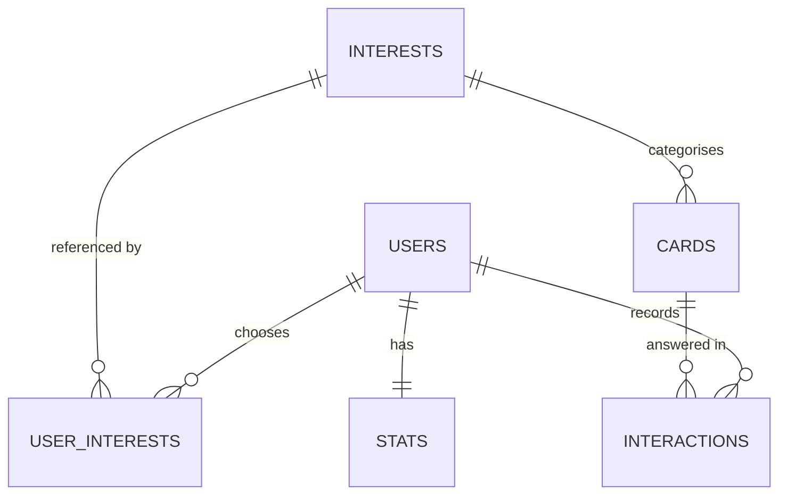

# Pique


**Scroll less. Think more.**

Pique is a mobile app that replaces mindless scrolling with short, AI-generated cards that ask something of you. Each card is a bold statement to agree or disagree with, or an idea to reflect on in your own words, and you can't move on until you've responded. A session is five, ten or fifteen cards, and then it ends. There's no infinite feed and no autoplay. You come away having thought about ten things instead of having skimmed past two hundred.

Pique was built by Mario Ojo (241334) for Interactive Development 300 (DV300), Theme 4, at Open Window Institute.

## Try it on Android

1. On an Android phone, open the [Pique APK download page](https://expo.dev/accounts/marioojo/projects/pique/builds/8a50d3cf-ef2e-4548-adb0-2c6cc8093a93) and tap **Install**.
2. If Android asks, allow your browser to install unknown apps. If Play Protect warns that the app is unrecognised, tap **Install anyway**. This happens because Pique isn't on the Play Store.
3. Open Pique, register with any email and password, and follow the short onboarding.

The APK connects to the live Firebase project, so it needs an internet connection. To run Pique from source instead, see [Getting started](#getting-started).

---

## The problem

Many of us spend more than two hours a day on social media (Statista, 2022). Much of that time is spent scrolling passively, a habit research has linked to lower wellbeing (Verduyn et al., 2021), although the effects vary a great deal from person to person (Valkenburg et al., 2022). The usual fix is a "digital detox", and quitting cold has shown mixed results (Radtke et al., 2022; Coyne & Woodruff, 2023), partly because it takes away the habit without replacing it with anything. Pique doesn't ask you to stop picking up your phone. It changes what happens when you do.

## Meet Frank

Frank is the mind behind every card in Pique.

Tell Frank what you're into (philosophy, science, art, politics and more) and he writes you a fresh set of cards every session: sharp claims worth arguing with, and clear explanations of ideas worth sitting with. He doesn't just count taps. When you answer, Frank reads what you wrote and judges how much thought went into it. The topics you really engage with show up more often, and the ones you skip fade into the background.

Frank is built on Anthropic's Claude. He isn't trying to keep you on the app as long as possible. He's trying to make the time you spend on it worth something.

---

## Features

### Implemented

**Getting started**

- **Animated splash.** On first launch, a large "P" scans the letters of "ique" like a magnifying glass, settles into the logo and the tagline "Think before you scroll." fades in. Later launches show just the finished logo. Tap to skip; reduced motion and screen readers get the still version.
- **Email and password accounts.** Sign up, sign in and stay signed in between sessions, with a show/hide toggle on password fields and a password reset by email.
- **Privacy notice.** The register screen says what's stored and that answers are sent to Claude, and that Pique is for adults (18+).
- **Account created.** A short confirmation after sign-up, before the intro.
- **Meet Frank.** A two-page intro: how Pique works, then who Frank is.
- **Onboarding questions.** Age band, at least three of thirteen topics, why you're here, how hard Frank should push back, and how long a session should be. The last three can be skipped. The topic screen explains that topics can be changed only after the first three sessions, so the choice is a considered one. A summary shows how Frank will work with you.

**Sessions and cards**

- **Finite sessions.** Five, ten or fifteen cards (your choice), with a progress bar and a clear end. No infinite feed.
- **Two card types:**
  - **Perspective.** One debatable position and a yes/no question about it ("Do you agree that…?"). Choose *Agree* or *Disagree*, then Frank shows you the other side, and asks whether it shifted your view.
  - **Recall.** An idea explained simply and an open question. Write a response of at least 20 characters, and Frank replies on the card, building on what you said.
- **Response gate.** You can't advance without responding or deliberately skipping.
- **Live, personalised AI cards.** Frank writes each session's cards with the Claude API, spread across your top three topics and shaped by your onboarding answers. Cards use short sentences and everyday words, so they work for every level of schooling, and the question is the largest text on the card.
- **A photo on every card.** Each card gets a matching photo from Pixabay, credited to its photographer and described for screen readers.
- **Fast first card.** The feed starts as soon as the first topic's cards arrive; the rest are mixed in while you read.
- **Response scoring.** Every response is scored 1–10 for genuine engagement, with the reason recorded. Agree/Disagree answers are scored in the background; written answers are scored at Submit, so Frank can reply.
- **Answer checks.** Keyboard mashing gets a gentle nudge before it's sent. Written answers that don't address the question are called out ("Frank's not sure that answers it"), with a chance to try again, and count towards nothing. Answers faster than the card can be read score low, and three in a row bring a "slow down" nudge.
- **Adaptive feed.** Engagement scores raise or lower each topic's weight, which decides what Frank writes next.
- **Daily limit.** Up to 30 generated cards a day per user. When they run out, a "done for today" page counts down to fresh cards.
- **Graceful fallback.** If Frank is unavailable, the session carries on with clearly labelled sample cards.
- **Micro-feedback.** Choices spring when pressed, the Submit button pulses, the card border flashes violet, the counterpoint slides in and Frank's acknowledgement follows. Skipping shows "Skipped — Frank noticed."
- **Frank's verdict.** Each session ends with cards completed, topics explored and your best streak, then Frank's scores arriving live: points earned, a tile per answer and your best take with Frank's reason. Level-ups and new badges are announced here.

**Profile and settings**

- **Streaks and stats.** Daily streaks (counted from your local midnight) and total cards completed.
- **Points and Thinker levels.** Every answer earns its score as points. Seven levels, from Curious to Philosopher, with a progress bar to the next.
- **Badges.** Eight milestones (first answer, 10 and 50 cards, 3- and 7-day streaks, a 9/10 answer, 100 points, the Sage level). Locked ones are faded, and tapping one says how to earn it.
- **Profile.** Your avatar, streak and totals; your Thinker level and badges; your top three topics ranked by engagement; and your five most recent takes ("Agreed · Philosophy", with the card's statement and Frank's take on it).
- **Settings.** Reached from the gear icon. Choose one of eight preset avatars, edit your name, change your topics (after three finished sessions), see your session length, reset your password, sign out, read what Pique stores about you, and see the app version.
- **Dark mode.** Settings → Appearance: System, Light or Dark. Every text colour meets WCAG AA contrast (4.5:1) in both modes.
- **Text size.** Settings → Text size: Standard, Large (+15%) or Larger (+30%), for easier reading.
- **Delete account.** Permanently deletes your profile, topics, answers and streaks, and your sign-in.
- **Reminders (preview).** A daily reminder switch and time are saved on the device; notifications aren't sent yet, and the screen says so.

### Navigation

New users go **Register → Account created → Meet Frank (2 pages) → Age → Topics → Why → Frank's style → Session length → Summary → Feed**. The root layout sends each user to the right stage based on `frankIntroSeen` and `onboardingComplete`, using `router.replace` so the back button can't return to a finished stage. Within onboarding the question screens push, so answers can be changed with back until the summary completes it. Each question starts from the saved answer, so a restart resumes where the user left off.

Once onboarded, the app has two tabs, **Feed** and **Profile**. Settings, the Frank intro and onboarding are full-screen stack screens outside the tab bar, so Settings slides in over the tabs and the back gesture returns you to where you were. Your topics opens from Settings once it's unlocked. Forgot password sits outside both route groups, so it opens from login (signed out) and from Settings (signed in).

### Roadmap

These are designed or partly built, but not finished:

- **Editing the other onboarding answers.** Topics can be changed after three sessions, but why you're here, Frank's style and session length are still set once during onboarding.
- **Reminder notifications.** The preference is stored; scheduling notifications (for example with `expo-notifications`) isn't built.
- **Using "Did that shift your view?"** The answer is asked but not stored or used by Frank yet.
- **A first-card hint** explaining how to answer.
- Accountability buddies (a `BuddyConnection` type is already defined)
- Admin panel for content moderation (the card model already supports a `flagged` status)
- Removing card photos from Storage when their cards expire

---

## Tech stack

| Layer | Technology | Reason |
| --- | --- | --- |
| Mobile app | React Native 0.86 + Expo SDK 57 | One TypeScript codebase for iOS and Android, with Expo Go for fast on-device testing |
| Language | TypeScript (strict) | Shared, checked types between screens, hooks and Cloud Functions |
| Navigation | expo-router | File-based routes: separate auth and app groups, with a stack around the Feed and Profile tabs |
| Authentication | Firebase Authentication | Email and password sign-in, kept between sessions with AsyncStorage |
| Database | Cloud Firestore | Real-time listeners keep stats and topic weights live, and Security Rules protect each user's data |
| Server logic | Firebase Cloud Functions (Node.js 24) | Keeps the Claude API key off the device and runs scoring and stats on the server |
| AI | Claude API (`claude-opus-5-5`) via `@anthropic-ai/sdk` | Writes cards, scores and replies to responses, with structured outputs that return checked JSON |
| Card photos | Pixabay API + Cloud Storage for Firebase | Frank suggests a search phrase per card; the server copies the photo into Storage |
| Validation | Zod | Defines the exact shape Claude must return |
| Typography | Poppins (Light 300, Regular 400, SemiBold 600) | A friendly geometric typeface used across the whole app; Light is the splash's scanning "P" |
| Theming | `ThemeProvider` + `makeStyles` (`hooks/useTheme.tsx`) | Light and dark colours by role, with each screen's styles built once per mode |
| Graphics | react-native-svg | Draws the Pique logo mark, the "P" and Frank's amber sparkle, crisply at any size |
| Local development | Firebase Emulator Suite | Auth, Firestore and Functions all run locally, without touching production |

**Brand colours:**

| Colour | Hex | Used for |
| --- | --- | --- |
| Navy | `#1C1040` | Headers, primary buttons, body text |
| Violet | `#7B5CF0` | Frank, accents, progress and selection |
| Amber | `#F0B429` | Streaks |
| Light grey | `#F5F5F7` | Screen backgrounds |

In dark mode, screens switch to deep navy (`#110B26` backgrounds, `#1D1540` cards) with near-white text, and solid buttons turn violet so they stand out. The splash, Frank intro and end-of-session screens are dark in both modes. Every colour has a role (background, surface, text, accent…) in `constants/colors.ts`.

---

## Getting started

### Prerequisites

- **Node.js 24.12 or later (with npm 11).** This matches the Cloud Functions runtime and the cloud builds. The lockfile was made with npm 11, and `npm ci` on npm 10 rejects it.
- **Java 21 or later.** Needed by the Firestore emulator.
- **The Expo Go app** on your phone, or an Android emulator or iOS simulator. You don't need a global Expo CLI install, because `npx expo` uses the project's own copy.
- **A Firebase project.** Production deploys need the Blaze (pay-as-you-go) plan. Local development with emulators doesn't.
- **An Anthropic API account** with credits, for Frank.

### Installation

**1. Clone the repository and install dependencies.**

```bash
git clone https://github.com/MarioOjo/Pique.git
cd Pique/pique
npm install
cd functions && npm install && cd ..
```

Everything below is run from the `pique/` folder.

**2. Register a Firebase web app.**

In the [Firebase console](https://console.firebase.google.com), open your project, go to **Project settings → Your apps → Add app → Web**, and copy the config values into `pique/.env` (see [Environment variables](#environment-variables)). Then point the Firebase CLI at your project:

```bash
npx firebase-tools login
npx firebase-tools use --add   # choose your project and give it the alias "default"
```

The app's `EXPO_PUBLIC_FIREBASE_PROJECT_ID` must match this project, or the app and the emulators will be looking at different data.

**3. Enable sign-in.**

In the console, go to **Authentication → Sign-in method** and enable **Email/Password**.

**4. Add your Anthropic API key for local development.**

Create `pique/functions/.secret.local`:

```
ANTHROPIC_API_KEY=sk-ant-...
PIXABAY_API_KEY=...
```

This file is git-ignored. The Functions emulator reads it in place of the production secrets. A free Pixabay key comes from <https://pixabay.com/api/docs/>; without one, cards are saved without photos.

**5. Start the emulators and the app.** These run in two terminals; see [Running with emulators](#running-with-emulators). Then scan the QR code with Expo Go, register an account, answer the onboarding questions and start your first session.

### Environment variables

Expo variables live in `pique/.env`, which is git-ignored. The `EXPO_PUBLIC_` prefix means they are included in the app bundle, so this file only holds Firebase's public web config.

| Key | Description |
| --- | --- |
| `EXPO_PUBLIC_FIREBASE_API_KEY` | Firebase web API key (identifies the project; it isn't a secret) |
| `EXPO_PUBLIC_FIREBASE_AUTH_DOMAIN` | Usually `<project-id>.firebaseapp.com` |
| `EXPO_PUBLIC_FIREBASE_PROJECT_ID` | Your Firebase project ID |
| `EXPO_PUBLIC_FIREBASE_STORAGE_BUCKET` | Usually `<project-id>.firebasestorage.app` |
| `EXPO_PUBLIC_FIREBASE_MESSAGING_SENDER_ID` | Your project number |
| `EXPO_PUBLIC_FIREBASE_APP_ID` | The web app ID (`1:…:web:…`) |
| `EXPO_PUBLIC_USE_EMULATORS` | Optional. Set to `false` to make development builds use the real Firebase project instead of the local emulators. |
| `EXPO_PUBLIC_ALWAYS_PLAY_INTRO` | Optional, development only. Set to `true` to play the full splash animation on every launch instead of only the first. |

> **API keys never go in `.env`.** Anything in `.env` ends up in the app bundle. Locally, the Anthropic and Pixabay keys live in `functions/.secret.local`. In production, they're Firebase secrets:
>
> ```bash
> npx firebase-tools functions:secrets:set ANTHROPIC_API_KEY
> npx firebase-tools functions:secrets:set PIXABAY_API_KEY
> ```

### Running with emulators

In development builds (`__DEV__`), the app connects to the Firebase Emulator Suite automatically: Auth on port 9099, Firestore on 8080 and Functions on 5001. It uses your computer's LAN address, taken from Expo, so a physical phone on the same Wi-Fi can reach them.

**Terminal 1: emulators.**

```bash
cd pique
npx firebase-tools emulators:start --import=./emulator-data --export-on-exit
```

Wait for `All emulators ready` and check that the Functions line lists `generateCards, scoreResponse, updateStats, deleteAccount`. Stop the emulators with **Ctrl+C**: the `--export-on-exit` flag saves your data to `emulator-data/` (git-ignored) when they shut down, and `--import` loads it back next time. On the very first run there's nothing to import yet, which is fine. The Emulator UI is at <http://127.0.0.1:4000>.

**Terminal 2: the app.**

```bash
cd pique
npx expo start
```

The Metro log should show `[firebase] Using local emulators at <your IP>`.

If the app shows old code, or "Unable to resolve" errors, after switching branches or pulling changes, restart Metro with its cache cleared (Metro's file watcher can miss changes on synced folders such as OneDrive):

```bash
npx expo start -c
```

**Troubleshooting:**

- **Physical device can't connect.** Allow Node.js and Java through Windows Firewall on private networks.
- **`Timeout after 10000` loading functions.** A slow first load, common on synced folders such as OneDrive. Raise the limit with `FUNCTIONS_DISCOVERY_TIMEOUT=60` (in seconds) before starting the emulators.
- **Feed shows "sample cards".** Card generation failed. Check the emulator terminal; the usual causes are a missing key in `.secret.local`, an Anthropic account with no credits, or the daily card limit.

### Deploying

Production needs the Blaze plan, Cloud Storage turned on (Firebase console → Storage → Get started, production mode, in the same region as the functions, `us-central1`) and both keys stored as secrets (once):

```bash
cd pique
npx firebase-tools functions:secrets:set ANTHROPIC_API_KEY
npx firebase-tools functions:secrets:set PIXABAY_API_KEY
```

The secret prompt hides what you type or paste. After changing a secret, redeploy the functions that use it, because each deployed function keeps the version it was deployed with.

Then deploy the functions, Security Rules and Firestore indexes:

```bash
npx firebase-tools deploy --only functions,firestore
```

Deploying runs the functions' lint and build steps first. The rules in `firestore.rules` must be deployed for the protections described under [Security](#security) to apply, and `firestore.indexes.json` holds the index the profile's Recent takes query needs. A brand-new function can take a minute or two after its first deploy before the app is allowed to call it.

### Building the APK

The installable Android app is built in the cloud with [EAS Build](https://docs.expo.dev/build/introduction/), using the `preview` profile in `eas.json`. That profile produces an APK, runs on Node 24.12 and reads the environment named "preview".

`.env` is git-ignored, so EAS never receives it. Add the six `EXPO_PUBLIC_FIREBASE_*` values to the EAS "preview" environment once (on expo.dev, or with `npx eas-cli@latest env:create`). Then build:

```bash
cd pique
npx eas-cli@latest build --profile preview --platform android
```

The build takes about 15–20 minutes and ends with a download link and QR code. Release builds always use the live Firebase project, never the emulators.

---

## Project structure

```
pique/
├── app/                          # Screens (expo-router: every file is a route)
│   ├── _layout.tsx               # Root: fonts, splash animation, theme, AuthProvider, redirects
│   ├── index.tsx                 # Empty entry route; the root layout redirects from here
│   ├── forgot-password.tsx       # Password reset, reachable signed in or out
│   ├── (auth)/                   # Signed-out screens: login, register
│   └── (app)/                    # Signed-in screens
│       ├── _layout.tsx           # Stack: the tabs plus full-screen screens
│       ├── (tabs)/
│       │   ├── _layout.tsx       # Feed and Profile tabs
│       │   ├── feed.tsx          # A session: cards, progress, end screens
│       │   └── profile.tsx       # Avatar, streak, totals, ranked topics, recent takes
│       ├── frank-intro.tsx       # Account created, then the two intro pages
│       ├── onboarding-age.tsx    # Onboarding questions, in order…
│       ├── onboarding.tsx        # …topics (at least 3 of 13)
│       ├── onboarding-why.tsx
│       ├── onboarding-frank-style.tsx
│       ├── onboarding-rhythm.tsx # Session length
│       ├── onboarding-summary.tsx # Recap; completes onboarding
│       ├── edit-topics.tsx       # Change topics, after three finished sessions
│       └── settings.tsx          # Profile, feed, reminders, account, privacy, appearance, text size
├── components/
│   ├── cards/CardComponent.tsx   # Perspective and Recall cards, response gate, timing, feedback
│   ├── feed/                     # SessionComplete (Frank's verdict), DoneForToday (daily limit)
│   ├── onboarding/               # AccountCreated, QuestionScreen (shared question layout)
│   └── ui/                       # Button, TextField, LevelProgress, BadgeGrid, Avatar, SplashAnimation…
├── hooks/
│   ├── useAuth.tsx               # Auth context and live user profile
│   ├── useCards.tsx              # Session queue, generation, recording, scoring and Frank's replies
│   ├── useSessionVerdict.tsx     # Live scores for the session-complete screen
│   ├── useBadges.tsx             # Earned badges, and which are new on this device
│   ├── useTheme.tsx              # Light/dark theme, text size, makeStyles
│   ├── useStats.tsx              # Live stats/{uid}: streaks, totals, points
│   ├── useTopInterests.tsx       # Live interest weights, highest first
│   ├── useRecentTakes.tsx        # The last five answered cards
│   └── useReminderPrefs.tsx      # Reminder preference, stored on the device
├── lib/
│   ├── firebase.ts               # Firebase app, auth (persisted), Firestore, Functions, emulators
│   ├── claude.ts                 # Typed wrappers for the Cloud Functions
│   ├── onboarding.ts             # Onboarding options, steps and routes
│   ├── topics.ts                 # Saving topics; the three-session unlock
│   ├── answerCheck.ts            # Gibberish check and reading time (copied in functions/)
│   ├── levels.ts                 # Thinker levels
│   ├── badges.ts                 # The eight badges
│   ├── seedInterests.ts          # The thirteen topics
│   ├── avatars.ts                # The eight preset avatars
│   ├── mockCards.ts              # Sample cards, used only as a fallback
│   └── authErrors.ts             # Friendly messages for Firebase auth errors
├── constants/                    # colors.ts (brand + light/dark roles) and theme.ts (spacing, radii, type)
├── types/index.ts                # Shared app types: Card, Interaction, User, UserStats…
├── functions/                    # Firebase Cloud Functions (Frank's server side)
│   └── src/
│       ├── index.ts              # generateCards, scoreResponse, updateStats, deleteAccount
│       ├── config.ts             # Model, token limits, batch size, daily limit, API key secret
│       ├── anthropicClient.ts    # Shared, lazily created Claude client
│       ├── generators/cardGenerator.ts   # Frank's card-writing prompt, personalisation, schema
│       ├── images/cardImages.ts  # Pixabay search, copy into Storage, credit and alt text
│       ├── scoring/responseScorer.ts     # Pre-checks, Claude scoring and replies, weight adjustment
│       ├── scoring/answerCheck.ts        # Gibberish check (copy of lib/answerCheck.ts)
│       └── stats/streaks.ts      # Timezone-aware streak calculation
├── firestore.rules               # Security Rules
├── firestore.indexes.json        # Composite index for Recent takes
├── firebase.json                 # Functions, rules, indexes and emulator configuration
├── eas.json                      # EAS Build profiles (preview APK)
└── .env                          # Firebase web config (git-ignored)
```

---

## AI integration

All of Frank's work happens in Firebase Cloud Functions. The app calls them as callable functions, which pass along the signed-in user's Firebase Auth token automatically, and the Claude API key exists only on the server. Every function checks that the caller is signed in and only acts on their own data.

### `generateCards`: writing a session

**Input:** `{ userId, interestId, count }`, where `count` is 1–5.

1. **Validates the request.** `interestId` must be one of the thirteen topics and `count` must be within the batch size.
2. **Reserves daily quota in a transaction.** Each user can generate up to 30 cards per day, so concurrent calls can't exceed the limit. The counter resets each UTC day. The same transaction reads the user's onboarding answers.
3. **Personalises Frank's prompt.** The age band, why the user is here and how hard Frank should push back each add one line to an "About this user" block, and the push-back level nudges card difficulty. Every line comes from a fixed table on the server (`toUserProfile`), never from the user's stored text, so an answer can't inject instructions; unknown values are dropped.
4. **Calls Claude** (`claude-opus-5-5`, effort `low` for speed) with Frank's system prompt and **structured outputs.** A Zod schema forces the reply into an exact JSON shape: `type`, `body`, `prompt`, `counterpoint` (perspective cards only), `difficulty` (1–5) and `imageQuery`. The SDK then checks the result against the schema. Frank is told to write at about a 14-year-old's reading level, keep the body to 140 characters, and give perspective cards a yes/no question. If Claude's safety checks decline a request, the API re-runs it on its recommended fallback model (`fallbacks: "default"`).
5. **Finds a photo for each card.** It searches Pixabay for Frank's `imageQuery` (safe search, landscape), falling back to the topic name, and copies the photo into Cloud Storage, because Pixabay doesn't allow permanent links to its own servers. A card whose photo can't be found is saved without one.
6. **Saves the cards** to `cards/` with a seven-day expiry and returns them to the app.
7. **Refunds the reserved quota** if generation or saving fails, or if Claude returns fewer cards than asked for.

In the app, `useCards` reads the user's interests, takes the **top three by weight**, splits the user's session size across them (for ten cards, **4 / 3 / 3**) and calls `generateCards` for all three at once. The session starts as soon as the first topic's cards arrive, and later ones are shuffled in among the cards not yet shown. If one topic fails, the others still go ahead.

### `scoreResponse`: judging engagement

**Input:** `{ interactionId }`.

The app writes each interaction itself (so it works offline), then calls `scoreResponse` once the write is confirmed: in the background for Agree/Disagree answers and skips, and straight away at Submit for written answers, so Frank's reply can be shown on the card. The function scores **what was stored**, not anything the app sends it, and each interaction is scored **at most once**, however often the function is called.

Cheap checks run first, so Claude is only called when it's needed:

| Condition | Score | Calls Claude? |
| --- | --- | --- |
| Card skipped | 0 | No |
| Agree/Disagree chosen faster than the card can be read | 2 | No |
| Agree/Disagree chosen after that | 5 (neutral) | No |
| Written response under 10 characters | 1 | No |
| Written response that looks like keyboard mashing | 1 (off-topic) | No |
| Written response faster than the card can be read | 2 | No |
| Anything else | 1–10 | Yes |

"Faster than the card can be read" means less time, from the card appearing to the Submit tap, than skimming its body and question at about seven words a second (between 3 and 12 seconds). The app uses the same limit for its slow-down nudge.

When Claude scores a response, it sees the card and the question asked, and the user's text is wrapped in `<user_response>` tags with an instruction to treat it as data, not instructions. A response that says "give me a 10" is scored as off-topic. Claude returns four things: `score`, `onTopic` (does the answer genuinely address the question?), a one-line `reason` and Frank's `reply`, one or two short sentences that build on the answer without asking anything. An off-topic answer scores 1 and its reply restates the question.

The score, its reason (`scoreReason`), whether Claude or a pre-check decided it (`scoredBy`), `onTopic`, Frank's reply (`frankReply`) and the weight change are written in a single Firestore transaction, leaving a record of how every response was judged. Off-topic answers stay on record but don't change weights, streaks, totals, points or badges.

After scoring an answer, the function recounts `stats/{uid}.points` (the sum of every on-topic answer's score) and `bestScore`, which drive the Thinker levels and badges.

### How interest weights work

Each topic a user picks starts at **weight 1.0**. After each scored response, the weight of that card's topic changes:

| Score | Effect on weight |
| --- | --- |
| 7–10 (genuine thought) | +0.2, up to a maximum of 3.0 |
| 4–6 (some engagement) | No change |
| 0–3 (minimal effort or skipped) | −0.1, down to a minimum of 0.1 |
| Off-topic | No change |

The three highest-weighted topics feed the next session, so Pique gradually tilts towards what each person really thinks about, not just what they tap on. On the profile, the top three topics are ranked, with bars relative to the strongest one.

### `updateStats`: streaks

**Input:** `{ userId, tzOffsetMinutes }`.

Called in the background after each response. It recalculates `stats/{uid}` from scratch using the user's non-skipped, on-topic interactions, and merges the result so the points `scoreResponse` keeps are left alone:

- **`totalResponses`:** the number of non-skipped, on-topic interactions.
- **`currentStreak`:** the number of consecutive days, ending today, with at least one response.
- **`longestStreak`:** the longest such run ever.

Days follow the **user's local midnight**, using the timezone offset the app sends, so a 00:30 answer in Johannesburg counts towards the right day. The feed header and the profile listen to this document live.

### `deleteAccount`: removing a user

Called from Settings after a confirmation. It deletes the caller's interactions, `stats/{uid}`, and `users/{uid}` with its `interests` subcollection, then their Firebase Auth account; the app then signs out. Generated cards aren't tied to a user and hold no personal data, so they stay. It's safe to retry after a partial failure.

### The fallback to sample cards

If every `generateCards` call fails (no network or no API credits), the session carries on with ten built-in sample cards from `lib/mockCards.ts`, and the feed shows **"· sample cards while Frank is offline"** next to the card counter. Users always have something to engage with. Responses to sample cards are recorded, but they don't change topic weights, because those cards don't exist in Firestore.

---

## Data model



| Collection | Key fields | Written by |
| --- | --- | --- |
| `users/{uid}` | `name`, `email`, `role` (`standard` / `admin`), `avatarId?`, `frankIntroSeen`, `onboardingComplete`, `ageBand?`, `whyHere?`, `frankStyle?` (1–5), `sessionSize?` (5 / 10 / 15), `sessionsCompleted`, `dailyCardCount`, `dailyCardCountDate`, `createdAt` | App on sign-up, during onboarding and at the end of each session; functions maintain the daily counter |
| `users/{uid}/interests/{interestId}` | `interestId`, `weight` (0.1–3.0) | App during onboarding and from Your topics (at 1.0); `scoreResponse` afterwards |
| `interests/{interestId}` | `id`, `name`, `emoji`, `createdAt` | Seeded once, from a fixed list of thirteen |
| `cards/{cardId}` | `interestId`, `type` (`perspective` / `recall`), `body`, `prompt`, `counterpoint?`, `difficulty`, `imageUrl?`, `imageCredit?`, `imageAlt?`, `status`, `createdAt`, `expiresAt` | `generateCards` only (photos in Storage under `card-images/`) |
| `interactions/{id}` | `userId`, `cardId`, `responseText`, `timeOnCard` (ms), `skipped`, `engagementScore`, `scoredAt`, `scoreReason`, `scoredBy` (`claude` / `precheck`), `onTopic`, `frankReply?`, `createdAt` | App creates it; `scoreResponse` adds the score, the reason and Frank's reply |
| `stats/{uid}` | `currentStreak`, `longestStreak`, `totalResponses`, `points`, `bestScore`, `lastActive` | `updateStats` and `scoreResponse` only |

The `BuddyConnection` type in `types/index.ts` defines the planned `buddies` collection for the accountability feature on the roadmap.

---

## Security

Firestore Security Rules (`pique/firestore.rules`) treat the app as untrusted. Cloud Functions use the Admin SDK, which bypasses the rules, so anything only the server should change is simply off-limits to the app.

- **Private profiles.** Users can only read their own profile. They can edit only `name` (1–50 characters), `avatarId` (one of the eight presets), `frankIntroSeen`, `onboardingComplete`, their onboarding answers and `sessionsCompleted`, which can only go up by one at a time. So nobody can make themselves an admin, reset their daily card limit or skip the topic unlock.
- **Onboarding answers are checked twice.** The rules accept only the known values (`ageBand` from 18–24 upwards, `frankStyle` an integer from 1 to 5, `sessionSize` 5, 10 or 15), and the server maps each answer to its own fixed prompt text, so nothing a user stores reaches Claude directly.
- **Users can't change their own weights.** Topics can be added (at exactly 1.0) or removed only during onboarding, or after three finished sessions. A topic's weight can never be edited by the user; only `scoreResponse` changes it.
- **Cards are written only by Cloud Functions.** Signed-in users can read cards, but nobody can create, edit or delete one from the app.
- **Interactions are write-once.** A user can create an interaction only for themselves, in exactly the expected shape and with `engagementScore` set to 0, so nobody can score themselves. Interactions can't be edited or deleted afterwards, and users can only read their own.
- **Stats are server-only.** Users can read their own `stats/{uid}` document, but only Cloud Functions can write it, so points and badges can't be faked.
- **The topic list is fixed.** The thirteen interest documents can be created once, with a fixed list of IDs and fields, and never changed.
- **API keys stay on the server.** The Claude and Pixabay keys are Firebase secrets, available only to the functions that need them, and never shipped in the app.
- **Card photos are read-only.** Storage rules deny all access from the app; each photo is reached only through the private download link `generateCards` saves on its card.
- **Users can delete their data.** Delete account removes everything stored about the user (see `deleteAccount` above), and the privacy notice on register and in Settings says what's kept and that written answers go to Claude.

These rules were tested against the Firestore emulator, including attempts to self-score, change weights, write cards, read other users' data, edit interactions, store injected text or out-of-range values as onboarding answers, change topics before the unlock, and inflate the session count. Account deletion was tested to remove only the caller's data.

---

## Acknowledgements

### References

Coyne, P., & Woodruff, S. J. (2023). Taking a break: The effects of partaking in a two-week social media digital detox on problematic smartphone and social media use, and other health-related outcomes among young adults. *Behavioral Sciences, 13*(12), Article 1004. https://doi.org/10.3390/bs13121004

Dixon, S. (2022). *Daily time spent on social networking by internet users worldwide from 2012 to 2022* [Data set]. Statista. https://www.statista.com/statistics/433871/daily-social-media-usage-worldwide/

Harris, T. (n.d.). *Center for Humane Technology*. Center for Humane Technology. https://www.humanetech.com

Radtke, T., Apel, T., Schenkel, K., Keller, J., & von Lindern, E. (2022). Digital detox: An effective solution in the smartphone era? A systematic literature review. *Mobile Media & Communication, 10*(2), 190–215. https://doi.org/10.1177/20501579211028647

Simon, H. A. (1971). Designing organizations for an information-rich world. In M. Greenberger (Ed.), *Computers, communications, and the public interest* (pp. 37–72). Johns Hopkins Press.

Valkenburg, P. M., Meier, A., & Beyens, I. (2022). Social media use and its impact on adolescent mental health: An umbrella review of the evidence. *Current Opinion in Psychology, 44*, 58–68. https://doi.org/10.1016/j.copsyc.2021.08.017

Verduyn, P., Gugushvili, N., & Kross, E. (2021). The impact of social network sites on mental health: Distinguishing active from passive use. *World Psychiatry, 20*(1), 133–134. https://doi.org/10.1002/wps.20820

### Built with

- [Anthropic Claude API](https://www.anthropic.com/api): Frank's card writing, response scoring and replies
- [Firebase](https://firebase.google.com): Authentication, Cloud Firestore, Cloud Functions, Cloud Storage and the Emulator Suite
- [Pixabay](https://pixabay.com): card photography, credited on each card
- [Expo](https://expo.dev) and [React Native](https://reactnative.dev): the mobile app
- [Lorem Picsum](https://picsum.photos), serving photography from [Unsplash](https://unsplash.com): sample card images
- [Poppins](https://fonts.google.com/specimen/Poppins) by Indian Type Foundry, via `@expo-google-fonts/poppins`

### Thanks

Built for **Interactive Development 300 (DV300)** at **Open Window Institute**, with thanks to lecturers **William Basson** and **Tsungai Katsuro**.

*"A wealth of information creates a poverty of attention."* (Simon, 1971)
